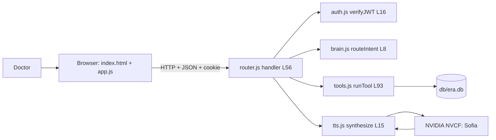
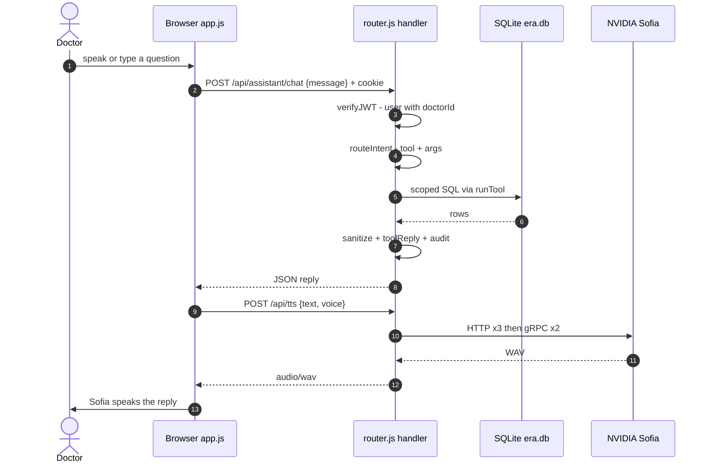

# Era — Full Flow: frontend → backend → database, end to end

> **v4.4.0** · companions: [Backend-Flow.md](Backend-Flow.md) (deep dive on the API + DB layer) · [Architecture.md](../Architecture.md) · all `file:line` links verified against source (2026-10-06).
> One document, the whole story: what happens from the moment the server boots to the moment Sofia finishes speaking an answer.

## Contents

1. [The system in one paragraph](#1-the-system-in-one-paragraph)
2. [The complete map](#2-the-complete-map)
3. [Phase 0 — Startup](#3-phase-0--startup)
4. [Phase 1 — The page loads](#4-phase-1--the-page-loads)
5. [Phase 2 — Signing in](#5-phase-2--signing-in)
6. [Phase 3 — Greeting](#6-phase-3--greeting)
7. [Phase 4 — The ask loop](#7-phase-4--the-ask-loop)
8. [Phase 5 — Voice out (Sofia)](#8-phase-5--voice-out-sofia)
9. [Phase 6 — The REST highway](#9-phase-6--the-rest-highway)
10. [Phase 7 — Leaving](#10-phase-7--leaving)
11. [The database across all of it](#11-the-database-across-all-of-it)
12. [Failure behaviour at a glance](#12-failure-behaviour-at-a-glance)
13. [One-line summary](#13-one-line-summary)

---

## 1. The system in one paragraph

Era is a voice-first clinic assistant. A browser page captures the doctor's question (spoken or typed) and sends it as one small JSON request. A single zero-dependency Node server authenticates the request, converts the sentence into a doctor-scoped database tool call, runs it against one SQLite file, sanitizes the result, and returns a human-sounding reply — which the browser then plays through NVIDIA's Sofia voice. Every step is audited, and a 40-check test suite pins the security model down.

## 2. The complete map

**Component view (GitHub renders this):**



**Request lifecycle (one chat message):**



**Plain-text fallback (same story):**

```
 FRONTEND (browser)              BACKEND (one Node process)                DATABASE (one file)
 ─────────────────               ──────────────────────────                ───────────────────
 index.html + app.js  ──login──▶  /api/auth/login ──▶ JWT cookie
        │
        │  🎤/⌨️ message          handler() [L56]
        ├────────────────────▶    ├─ verifyJWT()  → user
        │                        ├─ routeIntent() → tool + args
        │                        ├─ runTool() ──────────────────────────▶  db/era.db
        │                        │   (doctor-scoped SQL)                    10 tables
        │                        ◀──────────────────────── rows ──────────
        │                        ├─ sanitize() + toolReply()
        ◀────── JSON reply ──────┘
        │
        └─ speak(reply) ──▶ /api/tts ──▶ NVIDIA Sofia ──▶ WAV 🔊
```

---

## 3. Phase 0 — Startup

1. **Config first.** [server.js](../server.js) loads [lib/env.js](../lib/env.js) as its very first require, so the `.env` secrets (PORT, `JWT_SECRET`, the Sofia voice list, throttle limits) exist before anything reads them.
2. **The database opens with a parachute.** [lib/database.js](../lib/database.js) tries three locations for the SQLite file (`ERA_DB` → repo `db/` → `/tmp`), turns on foreign keys ([L21](../lib/database.js#L21)), creates the **10 tables** if missing, runs additive migrations for older databases, and **seeds demo data on first boot** ([L71](../lib/database.js#L71)): 3 doctors (Amit/Rahul/Priya), admin, front desk, 5 patients, appointments, prescriptions, 15 health answers.
3. **Freshness ritual.** Seeded demo appointments are re-dated to today/tomorrow on every boot, so "my appointments tomorrow" never comes back empty.
4. **Listeners up.** HTTP on **:8000** (plus an HTTPS mirror on :8443 when `certs/` exist). Both feed the same [`handler()`](../lib/router.js#L56).

## 4. Phase 1 — The page loads

1. The server serves the static trio — [index.html](../index.html), [style.css](../style.css), [app.js](../app.js) — with **no-cache** headers, so a stale cached script can never break the UI.
2. [app.js:6](../app.js#L6) defines one helper, `api()`, used for every call (it always sends cookies).
3. app.js immediately calls `GET /api/assistant/me` ([L228](../lib/router.js#L228)): a valid session goes straight into the workspace; anything else shows the **login card**.

## 5. Phase 2 — Signing in

Two doors, same destination — a JWT:

- **Email + password** — [`POST /api/auth/login`](../lib/router.js#L195): scrypt-hashed password check; a **new email auto-creates the account** and signs straight in (status 201). The server sets an HttpOnly `era_token` cookie **and** returns the token in the body. Too many failures → **429** from the two-counter throttle (8 per IP+email, 30 per IP, 15-minute window).
- **Demo login** — [`POST /api/assistant/demo-login`](../lib/router.js#L234): `{who:"doctorA"}` → Dr. Amit's session. Off by switch (`DEMO_LOGIN=0` makes the endpoint a 404).

Identity now exists only inside the token: `{id, role, doctorId, name}` — verified on every later request by [`verifyJWT()`](../lib/auth.js#L16), never taken from a request body or from the AI.

## 6. Phase 3 — Greeting

Entering the workspace, app.js builds a time-aware greeting ("Good evening, Dr. Amit! …"), remembers it in `sessionStorage` so refreshes stay quiet, and speaks it once through the voice pipeline (Phase 5).

## 7. Phase 4 — The ask loop (the heart)

1. **Capture.** Speech (Chrome's SpeechRecognition) or typing both funnel into [`ask()`](../app.js#L102) → `POST /api/assistant/chat` with `{message}` ([app.js:104](../app.js#L104)).
2. **Gate-keeping.** [`handler()`](../lib/router.js#L56) matches method+path and mints a `request_id`; [`verifyJWT()`](../lib/auth.js#L16) turns the token into a user (401 if missing). Bodies larger than 100 KB are cut off ([readBody](../lib/router.js#L49)).
3. **Understanding.** [`routeIntent()`](../lib/brain.js#L8) walks its intent ladder — reschedule is tested *before* book and cancel (so "move appointment 3" is not misread as a booking), then meetings, appointments, slots, patients, prescriptions, profile, then health Q&A via [`scoreRows`](../db/db.js#L61). [`pickDateTime()`](../lib/brain.js#L74) extracts "tomorrow at 4pm for Ravi" → `{date, start_time:"16:00", patient_name:"Ravi"}` (am/pm handled before 24-hour parsing, so 3:30 pm is 15:30).
4. **Doing.** [`runTool()`](../lib/tools.js#L93) executes the tool. [`scopeDoctor`](../lib/tools.js#L8) forces the doctor's own ID into every query; writes first pass the [`slotClash`](../lib/tools.js#L20) interval-overlap check (409 `SLOT_TAKEN` if occupied). All SQL is parameterized; patient data is only ever touched in this file.
5. **Saying it nicely.** [`sanitize()`](../lib/router.js#L303) strips internal IDs, [`toolReply()`](../lib/router.js#L285) renders "You have 2 appointments: …", and [`audit()`](../lib/router.js#L46) writes the trail — the reply's `request_id` matches the audit rows.
6. **Roles.** Staff without a doctorId asking for doctor data get a **polite 200 `denied:true`** with guidance text — and the tool layer still enforces the denial underneath.

## 8. Phase 5 — Voice out (Sofia)

1. [`speak()`](../app.js#L83) posts `{text, voice}` to `/api/tts` ([app.js:88](../app.js#L88)); `pickVoice()` chooses **EN-US or HI-IN Sofia** by detecting Devanagari or Hinglish wording.
2. [lib/tts.js](../lib/tts.js) checks the LRU cache (20 pairs), reads the key (`NVIDIA_API_KEY` env or gitignored `nvcf.key` — the key never reaches the browser), tries NVCF **HTTP 3×** with backoff, then the **gRPC Riva bridge** ([tts-grpc.py](../tts-grpc.py)) 2×, validating every response as a real RIFF/WAVE file.
3. The browser receives a WAV blob → `new Audio(URL.createObjectURL(blob))` → 🔊 Sofia speaks. The Stop button bumps a generation counter that invalidates any in-flight playback.

## 9. Phase 6 — The REST highway

Dashboards skip the brain and call tools/endpoints directly:

- [`GET /api/appointments`](../lib/router.js#L87) (filters `?date= ?from= ?to= ?status= ?upcoming=1`), [`POST /api/appointments`](../lib/router.js#L100) (409 on clash, `doctor_id` from auth), plus `GET/PATCH/DELETE /api/appointments/:id` — ownership always inside the SQL: `WHERE id=? AND doctor_id=?`. Another doctor's row is a **404**, not a 403, so existence is not even confirmed.
- [`GET /api/patients`](../lib/router.js#L153) and full [`/api/prescriptions`](../lib/router.js#L162) CRUD, all doctor-scoped.
- [`GET /api/schedule`](../lib/router.js#L138) (own working hours) and the shared clinic notice-board [`/api/clinic-schedule`](../lib/router.js#L142) (any signed-in role; no patient data in it).

## 10. Phase 7 — Leaving

[`POST /api/auth/logout`](../lib/router.js#L225) clears the cookie; app.js resets identity and the greeting flag. The JWT itself stays valid until its 8-hour expiry — stateless by design (a denylist would be the production upgrade).

## 11. The database across all of it

**10 tables:** `users`, `doctors`, `patients`, `doctor_patients` (the isolation backbone), `appointments`, `prescriptions`, `doctor_schedules`, `schedule` (clinic-wide notices), `ai_doctor` (health Q&A), `assistant_audit`.

| Concern | How it is handled |
|---|---|
| One file, one connection | Built-in `node:sqlite` driver ([database.js L4](../lib/database.js#L4)); the require cache hands the *same* `db` to tools, brain and router |
| Safety | `PRAGMA foreign_keys = ON`; parameterized queries only — injection is inert ([TEST 8](../test/security.test.js)) |
| Isolation | `doctor_patients` join + `WHERE doctor_id=?` everywhere; pinned by 40 automated checks |
| Truth | `assistant_audit` records every action, keyed by the same `request_id` the JSON reply carries |
| Resilience | 3-location open fallback, additive migrations, boot-time re-seed and re-dating |

## 12. Failure behaviour at a glance

| Situation | Response |
|---|---|
| Bad password | 401 (then 429 after the cap) — never reveals whether the email exists |
| No/expired token | 401 `AUTH_REQUIRED` with a sign-in prompt |
| Wrong role / no doctor profile | 403, or a polite 200 `denied:true` on chat |
| Someone else's data | 404 — existence not confirmed |
| Slot taken / duplicate meeting | 409, and chat *speaks the real reason* |
| NVIDIA voice down | 502 after HTTP+gRPC retries — "voice service unavailable" |

## 13. One-line summary

> **The frontend shows and speaks, the backend decides and guards, the database remembers — one process, one connection, one file, one audit trail.**

*Try it live: [../render.yaml](../render.yaml) deploys this to Render; mint a test token with [`node token.js doctorA`](../token.js); run the guards with `npm test`.*
